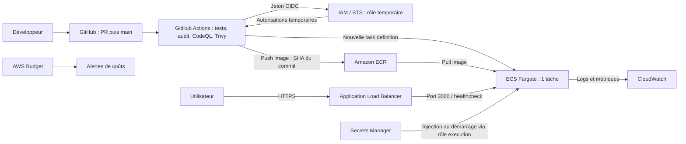

# TP 3 — Rendre une API prête pour la production

API Express du TP de clôture CI/CD : correction des trois routes vulnérables, tests de régression, audits, pipeline durci, image Docker et étude AWS. Comme les TP 1 et 2, le projet reste dans son propre dossier ; les configurations GitHub sont dans `../.github/`, seul emplacement exécuté par GitHub Actions.

## Installation et commandes

Depuis la racine du dépôt, avec Node.js 22 ou supérieur :

```powershell
cd TP3
npm ci --ignore-scripts
npm test
npm run test:coverage
npm audit --audit-level=high
npm start
```

L'API écoute sur `http://localhost:3000`. `PORT` peut être fourni par l'environnement ; `.env.example` documente sa valeur par défaut. Un fichier `.env` n'est pas chargé automatiquement.

| Méthode | Route | Résultat |
| --- | --- | --- |
| GET | `/health` | `200`, `{"status":"ok"}` |
| GET | `/hello?name=Lina` | Message HTML avec caractères spéciaux échappés |
| GET | `/ping?host=example.com` | Un ping sans shell ; 400 si invalide, 502 si injoignable, 429 si la limite est atteinte |
| GET | `/prefs?theme=dark&lang=en` | Préférences validées ; thèmes `light/dark`, langues `fr/en` |

## Sécurité & coûts

[](https://github.com/Romain397/TP-Integration/actions/workflows/ci.yml)
[](https://github.com/Romain397/TP-Integration/actions/workflows/codeql.yml)

Les badges suivent `main`. La [PR n° 1](https://github.com/Romain397/TP-Integration/pull/1) conserve les exécutions CI et CodeQL réalisées avant la fusion.

### 1. Secrets et clé AWS publiée

Les fichiers `.gitignore` excluent `node_modules/`, `.env`, `coverage/`, les logs et les artefacts locaux. `.env.example` contient uniquement `PORT=3000`. Le contexte Docker utilise une liste d'autorisation, sans secrets ni historique Git.

**Réponse à la question :** supprimer une clé dans un nouveau commit ne la retire ni de l'historique ni des clones et caches. Il faut la considérer compromise depuis sa publication.

1. Désactiver/révoquer immédiatement la clé AWS concernée, prévenir le responsable sécurité et ouvrir un suivi d'incident.
2. Examiner CloudTrail, les usages IAM, ressources et factures depuis la fuite ; préserver les traces et traiter les activités suspectes.
3. Créer un remplacement uniquement si nécessaire, avec les droits minimaux, mettre à jour les consommateurs dans un gestionnaire de secrets, puis supprimer définitivement l'ancienne clé. Pour GitHub Actions, préférer OIDC et des identifiants temporaires.
4. Nettoyer l'historique avec un outil adapté, coordonner la réécriture et les clones, puis activer/vérifier secret scanning et push protection. Le nettoyage ne remplace jamais la révocation.

**Secret Protection et Push protection sont activées sur GitHub**, état vérifié le 4 novembre 2026. La [preuve JSON issue de l'API GitHub](reports/github-security-settings.json) et sa [capture du contrôle API](reports/github-security-settings.png) consignent les paramètres réels. Cette capture représente le contrôle API, pas la page Settings du navigateur.

### 2. Dépendances

Audits réels conservés dans [reports/npm-audit-before.json](reports/npm-audit-before.json) et [reports/npm-audit-after.json](reports/npm-audit-after.json). Ils incluent les dépendances de développement. Les comptes peuvent évoluer avec la base d'avis de npm.

| État | Critical | High | Moderate | Low |
| --- | ---: | ---: | ---: | ---: |
| Avant : Express 4.17.1, Lodash 4.17.15 | 0 | 5 | 16 | 7 |
| Après : Express 4.22.3, Lodash 4.18.1 | 0 | 0 | 16 | 3 |

Le job `deps-audit` exécute `npm audit --audit-level=high` sur l'ensemble des dépendances. Les alertes restantes dans ce relevé proviennent de l'outillage Jest et de ses dépendances ; elles ne sont pas incluses dans l'image de production. L'[audit des dépendances de production](reports/npm-audit-production.json) (`npm audit --omit=dev`) ne trouve aucune vulnérabilité. Le seuil demandé bloque les niveaux High et Critical. Une mise à jour forcée qui rétrograderait Jest n'a pas été appliquée.

Dependabot couvre `npm` dans `/TP3`, `github-actions` à la racine et `docker` dans `/TP3`, chaque semaine. Les alertes et mises à jour de sécurité Dependabot sont également activées sur le dépôt ; leur état est consigné dans la preuve GitHub ci-dessus.

Pour reproduire l'état initial dans un dossier isolé :

```powershell
npm run baseline:prepare
npm ci --ignore-scripts --prefix .artifacts/baseline
npm test --prefix .artifacts/baseline -- --runTestsByPath tests/app.test.js
npm audit --prefix .artifacts/baseline --audit-level=high
npm test --prefix .artifacts/baseline -- --runTestsByPath tests/security.test.js --testNamePattern "régression"
```

Résultats attendus et vérifiés : les 2 tests initiaux passent, l'audit retourne un code d'échec, puis les 3 régressions échouent. Les processus sont simulés dans les tests : aucune commande injectée n'est exécutée. Le code vulnérable est archivé en texte dans `baseline/app.js.txt` et matérialisé uniquement dans `.artifacts/`, ignoré par Git.

Les manifestes initiaux sont également archivés en texte (`baseline/package.json.txt` et `baseline/package-lock.json.txt`). Le script les matérialise dans le même bac à sable. Ils restent reproductibles pour l'audit avant/après, sans être considérés comme des dépendances actives par le graphe GitHub ni provoquer des PR Dependabot sur le code volontairement vulnérable.

### 3. Les trois failles et leurs régressions

Les URL ci-dessous désignent uniquement l'ancienne application locale, jamais un service tiers.

| Route | Faille | URL d'attaque | Effet initial et correction |
| --- | --- | --- | --- |
| `/hello` | XSS réfléchie (CWE-79) | `http://localhost:3000/hello?name=%3Cscript%3Ealert(1)%3C%2Fscript%3E` | Le navigateur interprète le script dans la réponse HTML. `_.escape` encode le contenu ; nom scalaire limité à 200 caractères. |
| `/ping` | Injection de commande (CWE-78) | `http://localhost:3000/ping?host=127.0.0.1%3Bid` | Sur Linux, `;id` ajoute une commande avec les droits du serveur. Validation de l'hôte, rejet des options/métacaractères, `execFile` avec arguments séparés, sans shell, timeout et sortie limitée. |
| `/prefs` | Fusion profonde non contrôlée ; risque de pollution de prototype (CWE-1321) | `http://localhost:3000/prefs?constructor%5Bprototype%5D%5BisAdmin%5D=true` | L'ancienne route accepte des clés arbitraires et structures imbriquées. Suppression de `_.merge`, liste fermée de clés et valeurs, construction explicite de la réponse. |

**Précision sur `/prefs` :** le sujet présente cette route comme une pollution de prototype. Avec les versions exactes fournies, cette URL ne prouve pas à elle seule une modification de `Object.prototype` : des protections existent déjà dans Lodash 4.17.15. Le défaut démontré est l'acceptation d'une structure hors schéma ; par exemple `/prefs?isAdmin=true` ajoute une préférence arbitraire à la réponse initiale. Aucun contrôle d'autorisation du TP ne consomme ce champ : une élévation de privilèges effective n'est donc pas démontrée. Le test exige désormais le rejet de la tentative et l'absence de propriété globale polluée.

`tests/security.test.js` contient une régression pour chaque faille, ainsi que des cas de types incorrects, tableaux, valeurs imbriquées, options de commande et entrées trop longues. Les **36 tests passent**, avec **100 % des lignes** et **96,66 % des branches** couvertes dans `src/app.js`. Les preuves synthétiques figurent dans [reports/verification.json](reports/verification.json). La vérification locale utilise Node 24.14.0 ; le CI et l'image ciblent Node 22.

Lignes de la copie initiale `baseline/app.js.txt` à comparer aux alertes GitHub :

| Cas | Emplacement initial | Règle CodeQL de référence | Gravité de sécurité de la règle |
| --- | --- | --- | --- |
| XSS | ligne 12 | [`js/reflected-xss`](https://codeql.github.com/codeql-query-help/javascript/js-reflected-xss/) | 7.8 (High) |
| Commande | ligne 17 | [`js/command-line-injection`](https://codeql.github.com/codeql-query-help/javascript/js-command-line-injection/) | 9.8 (Critical) |
| Fusion non contrôlée | ligne 26 | Revue manuelle ; ne pas inventer une troisième alerte | Non mesurée par CodeQL localement |

Ce tableau décrit les règles de référence pour le code initial, pas trois alertes reçues. Le workflow CodeQL utilise la configuration avancée et analyse `TP3/src` avec `security-extended`. **Ne pas activer simultanément Default setup.** L'analyse a été exécutée sur la PR n° 1 : elle a détecté une alerte supplémentaire High, `js/missing-rate-limiting`, sur `/ping`. Une limite de dix pings réussis par minute et par IP a été ajoutée avec `express-rate-limit`, et `tests/rate-limit.test.js` vérifie le refus du onzième appel sans nouveau processus. La dernière version analysée n'a **aucune alerte CodeQL ouverte** ; voir la preuve GitHub.

Le compteur du limiteur est en mémoire, adapté à la tâche unique étudiée. En cas de déploiement derrière l'ALB, configurer les proxys de confiance selon le réseau réel ; le proxy n'est pas déclaré fiable par défaut. Plusieurs tâches nécessiteraient un compteur partagé pour une limite globale.

### 4. Pipeline durci et incident Trivy

Le workflow CI existant conserve les jobs Python des TP 1/2 et ajoute `test`, `deps-audit` et `image`. Il utilise :

- `push` sur `main` et PR vers `main` ; interface `workflow_call` pour réutiliser les contrôles avant déploiement ;
- `permissions: contents: read`, timeouts par job, concurrence avec annulation des anciennes exécutions CI ;
- `npm ci --ignore-scripts`, cache npm indexé sur le lockfile du TP3 ;
- actions du TP3 épinglées par SHA complet ; Trivy `v0.36.0` au commit `a9c7b0f06e461e9d4b4d1711f154ee024b8d7ab8`, moteur `v0.74.0` ;
- image construite après les tests et l'audit, cache BuildKit GitHub, test HTTP de démarrage et scan bloquant pour les High/Critical disposant d'un correctif.

Les SHA ont été résolus via `git ls-remote` sur les dépôts officiels. Dependabot permet leur actualisation par PR.

**Réponse à la question Trivy :** un workflow `@v0.34.0` exécuté pendant la fenêtre de compromission pouvait récupérer le code malveillant, car un tag est une référence modifiable. Un SHA complet pointant avant l'incident vers un commit sain reste attaché au même contenu malgré le déplacement des tags. Il faut cependant vérifier ce commit : épingler un SHA déjà malveillant ne protège pas, et les téléchargements/actions transitifs doivent aussi être maîtrisés. L'[avis officiel Aqua](https://github.com/aquasecurity/trivy/security/advisories/GHSA-69fq-xp46-6x23) confirme les versions affectées et les fenêtres d'exposition de mars 2026.

### 5. Images Docker

L'image finale utilise Node `22.23.4-alpine` épinglé par digest multi-architecture, deux étapes, les manifestes copiés avant le code, `npm ci --omit=dev`, `USER node` et `CMD ["node", "src/index.js"]`. L'arrêt SIGTERM ferme proprement le serveur. Seuls les modules de production, `package.json` et `src/` sont copiés dans l'image finale ; le cache npm, les tests, `.env` et `.git` restent exclus.

Le premier scan de la base Alpine avec les outils Node présents a trouvé **10 High corrigeables** dans les dépendances globales des gestionnaires de paquets (notamment `brace-expansion`, `pacote`, `sigstore`). npm, Corepack et Yarn sont donc retirés du système de fichiers final ; ils ne sont nécessaires que pendant la construction. Le scan porte sur l'image finale, pas seulement sur le lockfile applicatif.

Pour produire les mesures et les rapports Trivy sous PowerShell, Docker Desktop doit fonctionner en mode Linux :

```powershell
./scripts/measure-images.ps1
```

Le script reconstruit la baseline naïve, puis la version optimisée, mesure les tailles non compressées et les couches filesystem, scanne avec Trivy 0.74.0 épinglé par digest et vérifie `/health` avec l'utilisateur `node`. Les CVE sont comptées par occurrence paquet/CVE, sans masquer les failles non corrigeables ; le seuil bloquant du CI est plus précisément limité aux failles corrigeables.

| Image | Taille (MiB) | Couches filesystem | CVE HIGH | CVE CRITICAL |
| --- | ---: | ---: | ---: | ---: |
| Naïve | 1 619,41 | 11 | 532 | 20 |
| Optimisée | 239,27 | 9 | 0 | 0 |

Mesures réalisées le **4 novembre 2026**, après ajout du limiteur, en Linux/AMD64 : réduction de taille d'environ **85,2 %**. Le test HTTP renvoie `200 {"status":"ok"}`, et l'utilisateur configuré est `node`. Sur les 552 occurrences High/Critical de l'image naïve, 85 disposaient d'un correctif lors du scan ; l'image optimisée n'en conserve aucune. Les résultats bruts sont dans [reports/images.json](reports/images.json), `reports/history-*.jsonl` et `reports/trivy-*.json`.

**Réponse sur les couches et fichiers :** la plus grosse couche mesurée dans l'image naïve pèse **618 938 368 octets (590,27 MiB)** et installe notamment `autoconf`/`automake` et les outils de compilation de l'image Node Debian de base ; voir `reports/history-naif.jsonl`. Le Dockerfile naïf utilise `COPY . .` sans `.dockerignore` ; si `.env` ou `.git` existent dans son contexte, ils entrent dans l'image. `.gitignore` n'a aucun effet sur Docker. Supprimer un secret dans une couche suivante ne l'efface pas des couches précédentes.

Test manuel de l'image finale :

```powershell
docker build -t devsecops-tp:optim .
docker run --rm -p 127.0.0.1:3000:3000 devsecops-tp:optim
# Dans un deuxième terminal :
curl.exe --fail http://localhost:3000/health
```

### 6. Architecture cible AWS — étude uniquement



Architecture proposée : ALB public, tâches dans des sous-réseaux privés, entrée du security group des tâches limitée à l'ALB. Le choix NAT/VPC endpoints et leurs frais doit être chiffré. Secrets Manager représente les futurs secrets applicatifs ; cette API n'en utilise aucun et la définition de tâche n'en invente pas. Une tâche unique n'assure pas la haute disponibilité.

Calculs avec **les tarifs imposés par le sujet**, en dollars US, pour 0,25 vCPU et 0,5 Go ; aucune ressource AWS n'est créée.

| Scénario | Heures par mois | Calcul | Coût mensuel |
| --- | ---: | --- | ---: |
| A. x86, 24 h/24 | 730 | `730 × (0,25 × 0,04048 + 0,5 × 0,004445)` | **9,01 $** |
| B. ARM, 24 h/24 | 730 | `730 × (0,25 × 0,03238 + 0,5 × 0,003556)` | **7,21 $** |
| C. x86, 12 h × 5 jours/semaine | `730 × 5/7 × 12/24 = 260,714` | `260,714 × (0,25 × 0,04048 + 0,5 × 0,004445)` | **3,22 $** |

Le scénario C emploie le même mois moyen de 730 h que A/B. Avec une convention simplifiée de quatre semaines, ce serait 240 h et 2,96 $, mais cela ne représente pas le même mois moyen. L'arrêt/rétablissement du nombre de tâches serait à automatiser séparément ; il n'est pas inclus dans ce TP.

ARM économise environ 20 % sur le calcul Fargate, sous réserve de construire une image ARM64 et de modifier `runtimePlatform` (le bonus livré cible x86).

**Réponse à la question NAT :** `0,045 × 730 = 32,85 $/mois`, même sans trafic : environ **3,65 fois** le scénario A. Calcul Fargate + NAT : **41,86 $/mois**, avant ALB, stockage ECR, CloudWatch, Secrets Manager, IPv4 publique, transfert et traitement des données. Les composants réseau peuvent coûter plus cher que l'application ; il faut chiffrer l'architecture complète. Avant toute ressource, créer un budget et ses alertes ; les alertes seules ne plafonnent pas les dépenses.

La politique [aws/ecr-lifecycle.json](aws/ecr-lifecycle.json) expire les images au-delà des dix plus récentes, toutes étiquettes confondues (`tagStatus: any`). Avant une utilisation réelle, vérifier que les images nécessaires aux retours arrière restent conservées.

### 7. Bonus : déploiement OIDC

`../.github/workflows/deploy-aws.yml` se déclenche sur un push sur `main`. Tous ses jobs sont désactivés sauf si la variable de dépôt `AWS_ENABLED` vaut exactement `true`. Il réutilise la CI et CodeQL avec `needs`, construit et scanne l'image avant publication, obtient un rôle temporaire par OIDC, se connecte à ECR, pousse l'image taguée par `github.sha`, génère une nouvelle définition de tâche et attend la stabilité du service ECS.

`id-token: write` est limité au job `deploy`. Ce job utilise `environment: production` et sérialise les déploiements sans interrompre celui en cours. Il ne contient aucune clé AWS et ne crée ni cluster, ni service, ni rôle.

Prérequis pour une utilisation future, hors exécution du TP :

- environnement GitHub `production` avec les règles d'approbation appropriées ;
- variables de dépôt `AWS_ENABLED`, `AWS_REGION`, `AWS_ROLE_ARN`, `ECR_REPOSITORY`, `ECS_CLUSTER`, `ECS_SERVICE`, `ECS_TASK_FAMILY`, `ECS_EXECUTION_ROLE_ARN`, `ECS_TASK_ROLE_ARN`, `CLOUDWATCH_LOG_GROUP` ;
- rôle OIDC faisant confiance à `token.actions.githubusercontent.com`, audience `sts.amazonaws.com`, sujet limité à `repo:Romain397/TP-Integration:environment:production` ; déploiements de cet environnement limités à `main` ;
- droits minimaux ECR push, ECS register/describe/update et `iam:PassRole` sur les deux rôles de tâche uniquement ; rôle execution autorisé au pull ECR et à l'écriture des logs ;
- infrastructure, log group et service préexistants, ALB vérifiant `/health`, politique de rétention ECR appliquée.

### État du rendu et vérifications GitHub

Les trois TP sont regroupés dans le dépôt public `Romain397/TP-Integration`, selon l'organisation demandée. La [PR n° 1](https://github.com/Romain397/TP-Integration/pull/1) réunit les changements en conservant l'historique des commits ; la branche finale est `main`.

- Secret Protection, Push protection, alertes Dependabot et mises à jour de sécurité : activées et vérifiées par API.
- CodeQL : workflow avancé exécuté, alerte supplémentaire corrigée, aucun résultat ouvert sur la version vérifiée.
- Protection de `main` : PR obligatoire, branche à jour, contrôles `TP1 Python 3.12/3.13`, `TP2 Python 3.12/3.13`, `test`, `deps-audit`, `image` et résultat de sécurité `CodeQL` obligatoires ; règles applicables aux administrateurs ; force push et suppression interdits.
- Le contrôle CodeQL requis est lié à l'application **GitHub Advanced Security**, afin qu'une alerte bloque la fusion même si le job d'analyse a réussi son exécution.
- Déploiement AWS : préparé, désactivé par défaut ; aucune ressource AWS créée.

La preuve API contient la date et le commit effectivement contrôlés. Les captures rouge/vert sont conservées dans [TP1/docs](../TP1/docs/).
